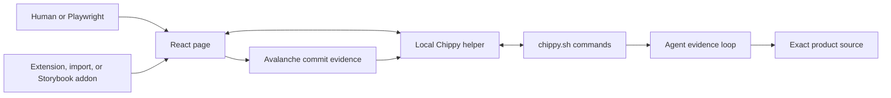

# Chippy

**A friend who helps you understand what’s happening, find the cause, and fix it.**

Chippy turns a running React page into source-level evidence. An agent can find and inspect components, drive interactions, and capture renders without a manually placed probe. From the UI, a developer can point at an element and attach an intent and comment to direct the agent. Both routes connect the rendered component, its owners, props, hooks, source location, and render behavior to the code the agent explains or changes.

That matters most in large applications where text search finds too many candidates, wrapper stacks hide ownership, and a hot component is easy to mistake for the update that triggered it.

## What Chippy helps answer

- Where did this rendered element or visible value come from?
- Which component, owner, prop, hook, context, or store shaped it?
- What changed after a click, route transition, or reload?
- Which update triggered a React render wave, and which components were collateral?
- Where should a correctness or performance fix live?
- Did the source edit change the same runtime signal that exposed the problem?

Chippy is an inspection and debugging system, not a general browser automation framework, production monitor, or static code-search tool. It needs a React page that can connect to the local helper.

For an unfamiliar task or failure signature, `./scripts/chippy.sh recipes <query...>` returns only the highest-ranked self-contained recipes from Chippy's local corpus. The corpus is also one-record-per-line for direct `rg` or `grep` use; deeper reference pages remain the canonical owners of detailed contracts.

## React support

No React or React DOM package patch is required. Commit capture uses the React
DevTools hook; an optional commit metrics adapter (the built-in one is ATL) adds
host-specific metrics after an actual adapter callback proves it is active. A metrics global alone does not prove support.
The hook must exist when React evaluates for renderer registration, commit capture,
and dispatcher-backed replay. Production builds can omit source, owner, replay,
and scheduling internals; Chippy reports unavailable evidence explicitly.

## Choose the workflow

| Starting point | Workflow | Primary evidence |
|---|---|---|
| An agent task on a connected page | Find fibers by name, text, test ID, source file, or prop; inspect and drive the target | Fiber, runtime state, source location, interaction and render evidence |
| A visible element or value | Place a probe, trace owners and props, open the reported source | DOM target, fiber, owner chain, source file and line |
| A slow interaction | Arm Avalanche, reproduce once, inspect the measured commits | Action breadcrumb, hot sources, commit-level causality |
| Slow initial load | Reload with Avalanche and inspect the bounded load window | Load commits, sources, restarts, unmounts, timing |
| A suspicious subtree | Schedule one controlled render and grade its stability | Clean/leak/cascade/trasher verdict |
| A suspicious hook | Interrogate the captured hook slot or measure recomputations | Hook primitive, custom-hook owner, tracker counts |
| Scripted or CI verification | Drive the page with Playwright and compare structured output | Replayed interaction plus probe/Avalanche JSON |

The runtime skill routes these cases: [SKILL.md](SKILL.md). The complete documentation chooser is [references/README.md](references/README.md).

## How evidence moves



The page-side integration resolves DOM and React runtime state. The helper keeps connected-page state and transports commands. `chippy.sh` exposes compact, stable views for the agent. Product source remains the place where fixes are made; runtime mutation is never a substitute.

## Connect a page

For an MCP-capable host, configure the [local stdio adapter](references/mcp.md).
It starts/reuses the helper automatically and exposes typed inspection,
profiling, and annotation tools. The CLI remains available for scripts and the
additional workflows routed by the skill.

Chippy supports three page-side integrations:

| Integration | Best fit | Reload behavior |
|---|---|---|
| Browser extension | A user-controlled browser tab | Re-injects automatically for enabled origins |
| Module import | A page without the extension UI | Applies to the current document; import again after reload/navigation |
| Storybook addon | A Storybook preview | Reconnects through preview annotations |

On extension-owned pages, Chippy starts as a small bottom-corner launcher. Expanding it reveals one unified panel with compact `P1 — drag to source` and `P2 — drag to source` rows that act as both dock and probe detail. Dragging a probe out keeps the panel expanded; once placed, the probe is document-anchored and follows its target during page scroll. The helper URL and plugin switches live behind its gear. Probe and connection updates patch existing controls in place, so drafts, focus, and the settings form survive ordinary refreshes. Active probes commit their annotation when the intent changes or Enter is pressed in the comment; Shift+Enter inserts a newline. The toolbar popup shows the Chippy mark and name with Enable and Disable for the current origin. Storybook is the intentional exception: its details live in the manager panel, so its preview frame retains a standalone probe dock.

When the extension workflow fits, load this skill's `extension` folder through **Load unpacked** in the browser's extension developer mode. The module-import and Playwright recipes live in [playwright-cli-setup](references/playwright-cli-setup.md).

From the Chippy skill directory, start the helper and verify the connection:

```bash
./scripts/chippy.sh start
./scripts/chippy.sh health
./scripts/chippy.sh pages
```

When the developer asks the current task to remain available for new browser annotations, use `./scripts/chippy.sh wait <clientId> [timeoutSeconds]`. It keeps one ordinary tool call open and returns the next attached probe subject, intent, and comment. Chippy does not install or modify agent-host hooks; repeated waiting is explicit and ends when the task is interrupted or loop mode is ended.

The agent runs helper commands outside its sandbox because the user's browser must reach the real local process. `pages` is the connection source of truth; in-page globals only prove that code loaded.

## Evidence model

Chippy deliberately keeps different facts separate:

- **Developer intent:** the optional `explain`, `investigate`, or `change` action and free-text comment attached to P1/P2 in the same interface as the target. It routes the task but is not runtime evidence.
- **DOM facts:** the exact element, text, attributes, styles, and nearest test-id boundary.
- **React facts:** the fiber, component, owners, parents, props, hooks, and source metadata for the current snapshot.
- **Declarative boundary facts:** every Error/Suspense ancestor around a target, or the whole page reduced to a boundary-only containment forest, including current Suspense content/fallback state.
- **Jira context:** optional probe enrichment for recognized ownership markers and `JSErrorBoundary` metadata; it appears in both the in-page and Storybook probe details once the Jira plugin is enabled (it is off by default), and does not replace source evidence.
- **Source facts:** what the reported file and code can do.
- **Render facts:** which commits, sources, restarts, effects, context updates, and collateral occurred in the measured window.
- **Action facts:** what the user or automation did immediately before a measured commit.

One fact type does not silently prove another. A source line does not prove it executed; a hot component does not prove it initiated a cascade; a loaded global does not prove an integration callback fired. Chippy joins those facts into a proof packet before recommending an edit.

## Package map

| Path | Responsibility |
|---|---|
| `SKILL.md` | Agent activation, routing, evidence gates, command contract, and completion rules |
| `references/` | Branch-specific procedures, schemas, output contracts, and troubleshooting |
| `references/recipes.txt` | Grep-friendly task-to-answer records used by local ranked recipe search |
| `scripts/chippy.sh` | Public command-line wrapper |
| `scripts/chippy-helper-server.js` | Local helper and page-command transport |
| `scripts/probe-annotation-channel.js` | Bounded in-memory annotation queue and cancellable wait lifecycle |
| `extension/` | Browser extension and bundled page runtime |
| `browser-scripts/` | Reusable Playwright session and probe support |
| `snippets/` | Version-controlled page-realm probes and reproducible stimuli |

The package is self-contained: runtime instructions and their required references, scripts, and assets live inside this directory. Start with `SKILL.md`, then open only the reference routed by the active investigation.

## Documentation map

- [Reference chooser](references/README.md): routes inspection questions to the relevant procedure or schema; use it to select which guide to load.
- [Recipe corpus](references/recipes.txt): one-line answers for common and uncommon Chippy operations, searchable with `chippy.sh recipes`.
- [Command surface](references/command-surface.md): every public shell command, grouped by responsibility.
- [Command output formats](references/command-output-formats.md): exact response envelopes and field semantics.
- [Browser runtime API](references/browser-runtime-api.md): globals, bridge capabilities, and page-side contracts.
- [Troubleshooting](references/troubleshooting.md): connection, bootstrap, probe, and capture recovery.
- [Snippet catalog](snippets/README.md): reusable page-realm probes and active-stimulus contracts.

Performance work has three distinct entry points:

- [Avalanche detector](references/avalanche-detector.md) captures and explains real interaction or load commits.
- [Stability render](references/stability-render.md) grades one subtree with a deterministic extra render.
- [Debug-hook](references/debug-hook.md) identifies a hook only after a capture supplies a source and hook index.

## Boundaries

- Chippy works from the connected page first. Playwright is used when automation or replay is required, not as a default replacement for an existing extension connection.
- Probes and commit captures are evidence anchors. Preserve them until the question is answered and any edit is verified.
- Development source resolution supports React <=18 `_debugSource` and React 19 `_debugStack` plus the dev server's source map. React 19 requires no JSX-runtime instrumentation when its development build and maps are available.
- Production or minified pages can reduce source and component confidence. Chippy reports the boundary instead of inventing missing detail.

## License

Chippy is licensed under the [MIT License](LICENSE).
