# Chippy

[](https://github.com/atlassian-labs/chippy/blob/main/LICENSE) [](https://github.com/atlassian-labs/chippy/blob/main/CONTRIBUTING.md)

**A friend who helps you understand what’s happening, find the cause, and fix it.**

<p align="center">
  <a href="assets/chippy-intro.mp4"></a>
  <br><a href="assets/chippy-intro.mp4">Watch with sound</a>
</p>

Chippy lets your coding agent see the React app running in your browser: which
component drew an element, its props and state, where it lives in source, and
what re-rendered during a slow interaction. Ask the agent, or point at an element
on the page and leave it a note.

Chippy works with standard React and needs no patched packages. Development
builds give the most detail. Chippy also works on production builds, including
for performance profiling, with limits: names may be minified and source
locations are unavailable, and every answer says what was available. Keeping
`displayName`s in production code helps a lot. See [React compatibility](https://github.com/atlassian-labs/chippy/blob/main/docs/react-compatibility.md#production-builds).

## What you can ask

- **Explore:** "Which components render this list, and what state do they hold?"
- **Debug:** "Where does this label's text come from?" or "Which boundary shows this spinner?"
- **Compare:** "What changed in the tree between these two states, or these two pages?"
- **Investigate:** "Why is this click slow?", "What re-renders on initial load?",
  or "Which component shifted the layout or delayed LCP?"

## Install

Chippy has three parts:

- The **agent skill** tells your coding agent how to run Chippy.
- The **local helper** is a small server on `127.0.0.1:7823`. The agent starts
  it when it needs it.
- The **page runtime** runs inside the page and reads React.

The skill and the helper are the same in every setup. You choose how the page
runtime gets into the page; see [Connect a page](#connect-a-page).

You need Node.js 22.20 or later, which the skills CLI requires.

1. Install the agent skill with the [skills CLI](https://github.com/vercel-labs/skills):

   ```sh
   npx skills add atlassian-labs/chippy --skill chippy -g
   ```

   Choose your coding agents when it asks, or name them with `-a`, for example
   `-a claude-code`. With `-g`, every project can use the skill, and its files
   live in `~/.agents/skills/chippy`; each agent's skills folder links to that
   copy. Leave out `-g` to install it in the current project's
   `.agents/skills/chippy` instead. Run `npx skills update chippy` to update it.

2. Connect a page with one of the routes in [Connect a page](#connect-a-page).

3. Ask your agent to use Chippy on the page.

The agent runs Chippy through the skill's `chippy.sh` script, which needs bash
(macOS, Linux, or WSL on Windows). You don't start anything yourself: the agent
starts a local helper on `127.0.0.1:7823` when it needs one. A sandboxed agent
asks for permission to reach it; approve the prompt or allow `chippy.sh`. If
your agent runs in a container or on a remote machine, the browser must reach
the helper's port through an SSH tunnel, a published container port, or other
forwarding your environment provides; Chippy does not set that up.
[Local and wide binds](https://github.com/atlassian-labs/chippy/blob/main/docs/trust-boundary.md#local-and-wide-binds)
lists what to set for each setup.

**Optional: connect over MCP.** If your agent supports MCP, it can call Chippy
as tools instead of running a script. Ask it:

> Connect Chippy over MCP using the MCP setup steps in the Chippy skill.

The agent adds the Chippy server to its own MCP configuration and checks the
connection. Some agents need a restart before the new tools appear. To set it
up yourself, see [MCP setup](https://github.com/atlassian-labs/chippy/blob/main/.agents/skills/chippy/references/mcp.md).

## Connect a page

Every route loads the same page runtime and talks to the same helper. The
routes differ in what you set up, whether Chippy stays after a reload, and
whether Chippy can record the initial page load.

| Route | What you set up | After a reload | Records the initial load |
| --- | --- | --- | --- |
| [Browser extension](#browser-extension) | Load the extension once, then enable it for each site | Chippy loads again | Yes |
| [Agent-driven browser](#agent-driven-browser) | Nothing. The agent opens its own Playwright browser | Chippy loads again | Yes, when the agent loads Chippy before the page |
| [Local proxy](#local-proxy) | Nothing. The agent starts the proxy, and you open the proxy address | Chippy loads again | Yes |
| [Storybook addon](#storybook-addon) | Add the addon to your Storybook configuration | Chippy remounts the story and stays | The story's mount |
| [Console import](#console-import) | Paste one line into the page's console | Chippy is removed. Paste the line again | No |
| [Your app's code](#your-apps-code) | Install the npm package and call `connectChippy()` | Call it again | No |

"Records the initial load" means that the agent can reload the page and record
the renders from the first commit. Every route records renders that happen
after Chippy connects.

### Browser extension

Use the extension for day-to-day work in your own Chrome or Chromium browser.

1. Open `chrome://extensions`, turn on **Developer mode**, and choose
   **Load unpacked**. Select the skill's `extension` folder:
   `~/.agents/skills/chippy/extension`, or `.agents/skills/chippy/extension`
   in your project if you installed without `-g`. The folder picker hides
   folders whose names start with a dot, so type the path instead of browsing.
   On macOS, press **Cmd+Shift+G**, paste the path, press **Return**, and
   choose **Select**. On Linux, press **Ctrl+L** and paste the path. On
   Windows, paste it into the address bar. After `npx skills update`, click
   **Reload** on the Chippy card in `chrome://extensions`.
2. Open your app, click the Chippy extension icon, choose **Enable** for the
   page's origin, and then reload the page. Later loads of that origin load
   Chippy automatically.

### Agent-driven browser

The agent opens a Playwright browser, loads Chippy into the page, and drives
the page itself. No extension is needed. Use this route for repeatable flows,
headless checks, and CI. Ask your agent to open the page with Chippy in
Playwright; the skill has the setup steps.

### Local proxy

The helper can sit in front of a dev server on your machine and add Chippy to
the page before the page's own scripts run. No extension is needed, and this
route works in any browser, including one that your agent drives. Ask your
agent to start the Chippy proxy for your page, then open the address that it
gives you on `127.0.0.1:7823`. The proxy forwards only to servers on this
machine, and it adds Chippy only to the page address that the agent gave it.
It removes the page's Content Security Policy headers, so it also works for
pages that block the console import.

### Storybook addon

In Storybook 10.3 or later, add the addon to your Storybook configuration:

```js
export default {
  addons: ['@atlassian/chippy/storybook'],
};
```

The addon adds Chippy panels to Storybook and connects each story to your agent.
When the agent reloads the page, Storybook remounts the current story instead of
reloading the preview. See the
[package documentation](https://github.com/atlassian-labs/chippy/blob/main/docs/npm-package.md#storybook)
for build targets.

### Console import

Use this for a quick look at a page where you cannot install the extension.
Once the agent has started the helper, paste this into the page's console:

```js
import('http://127.0.0.1:7823/__chippy/inject.mjs')
```

A reload removes Chippy, so paste the line again after every reload or
navigation. Sites with a strict Content Security Policy block the import.

### Your app's code

For pages that the extension cannot reach, such as an embedded browser, call
`connectChippy()` from `@atlassian/chippy/browser` in the page. It loads the
same runtime as the console import. See
[Connect a browser page to an agent](https://github.com/atlassian-labs/chippy/blob/main/docs/npm-package.md#connect-a-browser-page-to-an-agent).

## Ask the agent, or point at the page

- **Ask the agent** about the page. It finds components by name, text, test ID,
  source file, or prop, reads their state, clicks through the page, and records
  renders.
- **Point at the page:** click the Chippy button in the page corner and drag a
  probe marker (P1, or P2 to compare two elements) onto an element. Choose
  whether you want it explained, investigated, or changed, and add a note. Then
  ask the agent to read it, or to keep watching for new notes while you click
  around. The extension and the local proxy show the Chippy button. In
  Storybook, open the **Chippy** addon panel and choose **Show probes**; the
  P1/P2 dock appears in the story preview. The plain console import shows no
  probe UI; import `http://127.0.0.1:7823/__chippy/inject.mjs?ui=panel` to add
  the Chippy button and P1/P2 panel.

<p align="center">
  <a href="assets/chippy-call.mp4"></a>
  <br><a href="assets/chippy-call.mp4">Watch with sound</a>
</p>

## Evidence, then edits

The agent works from what actually rendered instead of guessing from a code
search. Some deep inspections re-run a component's code; if your components have
side effects during render, say so and the agent uses read-only inspection
instead. Chippy changes your source only when you ask it to, and checks the fix
against the same page.

## Use Chippy without an agent

The `@atlassian/chippy` npm package also works with no agent, helper, or
extension:

- **Catch re-render regressions in tests.** Record which components rendered
  during an interaction, and why, in a test or a script. Install the recorder in
  your app's entry module before React DOM loads, and it records from the first
  commit.
- **Ship your own build** with extra plugins for your stack.

See the [package documentation](https://github.com/atlassian-labs/chippy/blob/main/docs/npm-package.md) for setup.

## How Chippy compares

Other tools read what React already exposes, such as a component name or a
source line, and hand it to a person or an agent. Chippy is a system of three
parts that work together:

- **In the browser,** Chippy walks React's fiber tree, owners, props, and hooks,
  records commits during an interaction or page load, and can replay a
  component's render to see how its hooks produced a value.
- **The local helper** stores that evidence and gives the agent only what it
  needs: compact summaries instead of raw trees, renders ranked by where a
  cascade started, and diffs between snapshots of two states or two pages.
- **The agent acts back on the page** at the React level, not only through
  clicks: it finds fibers by name, text, test ID, file, or prop, forces a single
  component to re-render, calls a component's callbacks directly, and records
  what happens.

| Tool | Built for | What it gives you | Where it stops |
| --- | --- | --- | --- |
| [React Developer Tools](https://react.dev/learn/react-developer-tools) | A person in DevTools | Component tree, props, state, hooks, and the Profiler | You read the panels and decide what to change |
| [react-grab](https://www.react-grab.com/) | A person handing off to an agent | Hover an element and copy its component name, file and line, and HTML for your agent | Your agent takes it from the pasted context |
| [react-scan](https://react-scan.com/) | A person watching the page | Render outlines, a toolbar showing what changed, and alerts on slow frames | Shows what is slow; finding the cause and fixing it is up to you |
| [agent-browser](https://github.com/vercel-labs/agent-browser) | An agent driving a browser | Navigation, clicks, form input, snapshots, and screenshots | Works at the DOM and accessibility level, not inside React |
| **Chippy** | An agent working from runtime evidence | Live React state, render recordings, and snapshot diffs, reduced for the agent, plus React-level actions on the page | Changes the source when you ask, then re-checks the same page |

**Compared with react-grab.** Both start when you point at something on the
page and the tool works out which React component it is. react-grab copies that
context to your agent and its work is done. For Chippy, that is the first step.
A probe resolves the owner chain, hooks, and props, so the agent can follow a
value up the chain to the component that created it, past components that only
pass it along. Two probes resolve to their nearest common parent. The agent then
opens the source line, makes the change, and probes again to confirm it.

**Compared with react-scan.** Both answer "what rendered, and why?" react-scan
shows the answer on the page for a person to read. Chippy returns it as data for
an agent to build on. Render recordings cover both a single interaction and the
initial page load. The helper ranks them by where a render cascade started, not
only by how long each component took, so the agent can tell the component that
caused a slowdown from the ones that rendered along with it. The agent can then
re-render a single component on purpose to test a fix, and record again to
confirm the cascade is gone.

**Compared with React Developer Tools.** Chippy reads the same information
through React's DevTools hook and adds the steps a person would otherwise do by
hand: tracing a value to where it comes from, replaying a render to explain a
hook, comparing two states or pages, and separating the trigger of a slow
interaction from collateral renders.

**Compared with browser automation.** Tools such as agent-browser or Playwright
operate the page as a user would: they click, type, and take screenshots. Chippy
operates it from inside React and explains what React did in response. They work
well together. The agent uses an automation tool to repeat a user flow and
Chippy to inspect, nudge, and record the result, and keeps going until the
change is verified.

## Learn more

- [Agent skill](https://github.com/atlassian-labs/chippy/blob/main/.agents/skills/chippy/SKILL.md) and its [references](https://github.com/atlassian-labs/chippy/blob/main/.agents/skills/chippy/references/README.md)
- [React compatibility](https://github.com/atlassian-labs/chippy/blob/main/docs/react-compatibility.md)
- [Plugins](https://github.com/atlassian-labs/chippy/blob/main/docs/plugins.md) for app-specific knowledge
- [Trust boundary](https://github.com/atlassian-labs/chippy/blob/main/docs/trust-boundary.md): what page data Chippy sees and who can reach the helper
- [Security policy](https://github.com/atlassian-labs/chippy/blob/main/SECURITY.md)
- [Changelog](https://github.com/atlassian-labs/chippy/blob/main/CHANGELOG.md)

To build, test, or change Chippy, see [Contributing](https://github.com/atlassian-labs/chippy/blob/main/CONTRIBUTING.md) and the
[code of conduct](https://github.com/atlassian-labs/chippy/blob/main/CODE_OF_CONDUCT.md).

## License

Copyright (c) 2026 Atlassian US., Inc.
Apache 2.0 licensed, see [LICENSE](https://github.com/atlassian-labs/chippy/blob/main/LICENSE) file.

[](https://www.atlassian.com)
